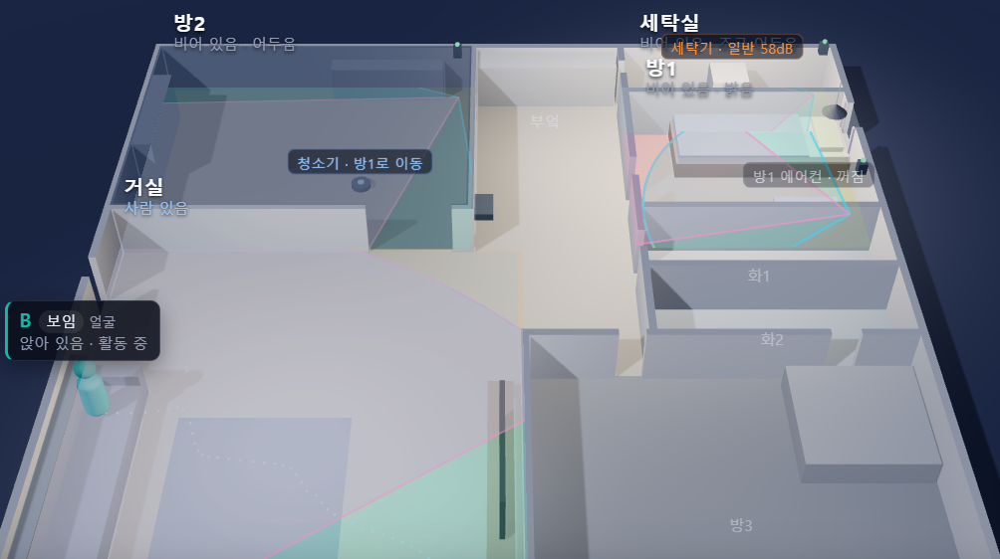

# EYEAR World Model

Home-wide state and simulation for [EYEAR](https://github.com/HY-LG-EYEAR).

**Maintainer:** Hyochang Lee

This module combines observations from room Nodes into a shared home state, including occupancy, residents, activities, and appliance states. It supplies WorldSnapshot data to the Orchestrator and maintains the home simulation and virtual appliances.

Python 3.11.

## Example

Home simulator view (`sim/`): each room's occupancy and light, resident identity, posture and activity, and appliance states that the World Model tracks.

| Whole home | Room 1 close-up |
|---|---|
|  |  |

## Interface

[Radar data specification](EYEAR_레이더_데이터_명세서.md)

## WorldSnapshot 2.0 (World Model → Orchestrator, 2026-11-13 협의안)

| 경로 | 내용 |
|---|---|
| `worldmodel/contract/models.py` | 2.0 Pydantic 모델 (모든 키 필수, extra 금지) |
| `worldmodel/contract/semantic.py` | `check(snapshot)` — ID 참조·중복·온도 간격 등 의미 검증 |
| `worldmodel/contract/receiver.py` | 수신측 참조 구현 — 202/409/422, 세션 등록, `can_issue()` |
| `worldmodel/contract/json/WorldSnapshot_2_0.schema.json` | `py -m worldmodel.contract.export`로 생성 |
| `worldmodel/contract/examples/` | 협의안 문서의 전체 JSON 예제 |
| `worldmodel/engine.py` | Node v0.1 메시지·기기·앱 설정 → 2.0 스냅샷 |
| `config/home_demo.json` | 방·Node·person_id 매핑·영향도·TTL (합의 전 제안값) |

```python
eng = WorldEngine(load_config("config/home_demo.json"))
eng.ingest_node(node_message_dict, received_at=now)   # MQTT eyear/v0/{room}/state
snap = eng.poll(now)                                  # 보낼 때면 WorldSnapshot, 아니면 None
```

테스트: `pip install -e .[dev]` 후 `pytest` (Python 3.11+).

v0.1 스키마(`worldmodel/schema/`)는 그대로 두었다.
