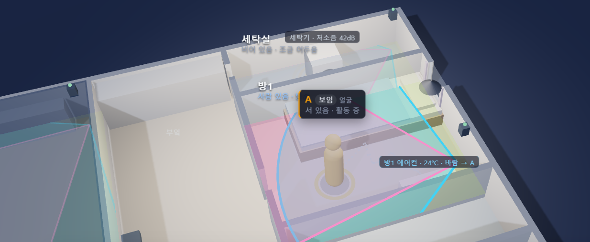

# EYEAR World Model

Home-wide state and simulation for [EYEAR](https://github.com/HY-LG-EYEAR).

**Maintainer:** Hyochang Lee

This module combines observations from room Nodes into a shared home state, including occupancy, residents, activities, and appliance states. It supplies WorldSnapshot data to the Orchestrator and maintains the home simulation and virtual appliances.

Python 3.11.

## Example

Home simulator view (`sim/`): each room's occupancy and light, resident identity, posture and activity, and appliance states that the World Model tracks.

| Whole home | Room 1 close-up |
|---|---|
|  |  |

## Interface

[Radar data specification](EYEAR_레이더_데이터_명세서.md)

## 실행 (실제 연동)

```
Node ──MQTT──▶ World Model (worldmodel.live) ──HTTP──▶ 중앙 :8765 ──MQTT 명령──▶ 가전 시뮬레이터 (worldmodel.device_sim)
                    ▲                                                                   │
                    └──────────────── eyear/v0/device/{id}/state·result ◀───────────────┘
```

```bash
pip install -e .                       # pydantic, paho-mqtt

# 1) World Model: Node·가전 상태를 받아 중앙에 스냅샷을 보낸다
python -m worldmodel.live --mqtt <브로커> --orchestrator http://<중앙 주소>:8765

# 2) 가전 시뮬레이터: 실제 가전 대신 상태를 보내고 중앙의 명령을 받는다 (중앙은 DEVICE_TRANSPORT=mqtt)
python -m worldmodel.device_sim --mqtt <브로커>
```

- `live`는 프로필·루틴을 `config/app_demo.json`에서 읽는다 (`--app-data`). 청소 루틴은 청소기가 상태를 보고한 뒤에만 스냅샷에 들어간다.
- 가전 시뮬레이터가 없으면 스냅샷에 기기가 없어서, 중앙은 조명 끄기·청소 같은 명령을 내지 않는다.
- 기기 목록은 중앙 fixtures와 같다: `vacuum_01`(kitchen), `washer_01`(laundry), `ac_room1`, `ac_living`, `light_room1`, `curtain_room1`.
  청소기는 방마다 `--room-s`초(기본 20) 청소한 뒤 도크로 돌아와 `completed`를 보낸다.
- 방을 옮긴 사람 이어 붙이기는 기본으로 꺼져 있다. `config/home_demo.json`에 `"handoff_s": 10`을 넣으면 켜진다 (규칙은 `docs/고민_목록.md` B1).
- 장치 없이 시험: eyear-node의 `python -m recorder.replay recorder/samples/2026-11-19_room1_rest_passerby.jsonl --mqtt <브로커>`

## WorldSnapshot 2.0 (World Model → Orchestrator, 2026-11-13 협의안)

| 경로 | 내용 |
|---|---|
| `worldmodel/contract/models.py` | 2.0 Pydantic 모델 (모든 키 필수, extra 금지) |
| `worldmodel/contract/semantic.py` | `check(snapshot)` — ID 참조·중복·온도 간격 등 의미 검증 |
| `worldmodel/contract/receiver.py` | 수신측 참조 구현 — 202/409/422, 세션 등록, `can_issue()` |
| `worldmodel/contract/json/WorldSnapshot_2_0.schema.json` | `py -m worldmodel.contract.export`로 생성 |
| `worldmodel/contract/examples/` | 협의안 문서의 전체 JSON 예제 |
| `worldmodel/engine.py` | Node 0.1·0.2 메시지·기기·앱 설정 → 2.0 스냅샷 |
| `worldmodel/hub.py` · `worldmodel/live.py` | 여러 방 동시 수신, MQTT 구독·중앙 HTTP 전송 |
| `worldmodel/device_sim.py` | 가전 시뮬레이터 (MQTT) |
| `config/home_demo.json` | 방·Node·person_id 매핑·영향도·TTL (합의 전 제안값) |

```python
eng = WorldEngine(load_config("config/home_demo.json"))
eng.ingest_node(node_message_dict, received_at=now)   # MQTT eyear/v0/{room}/state
snap = eng.poll(now)                                  # 보낼 때면 WorldSnapshot, 아니면 None
```

테스트: `pip install -e .[dev]` 후 `pytest` (Python 3.11+).

v0.1 스키마(`worldmodel/schema/`)는 그대로 두었다.
